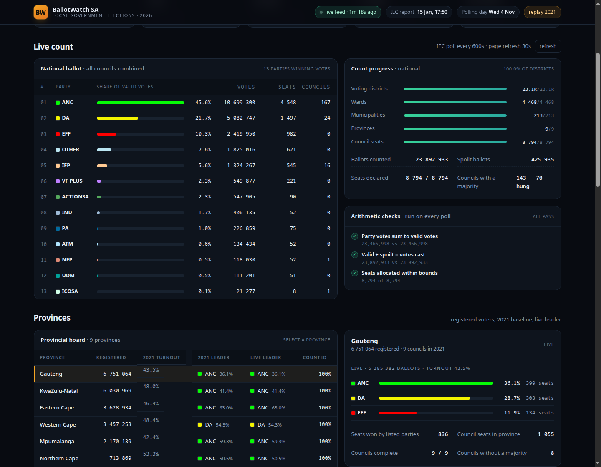

# BallotWatch SA

**A live, verifiable dashboard for South Africa's 2026 Local Government Elections
(Wednesday 4 November 2026).**

BallotWatch carries the pre-poll picture — the certified voter roll, the 2021
baseline, turnout history, the shape of the contest — and then follows the
Electoral Commission's own results feed on election night: national, provincial
and council level, with the arithmetic reconciled on every refresh.

**Live:** [https://zarpolls.online](https://zarpolls.online) — static snapshot,
re-published with `make publish`.

> Independent civic project. Not affiliated with, endorsed by, or speaking for the
> Electoral Commission of South Africa. Figures are provisional until the IEC
> declares a result.



---

## Why this exists

South Africa's local elections decide 213 councils, 8 824 council seats and
4 485 wards — the layer of government that delivers water, electricity, refuse
and rates. National vote share gets the headlines; **council control is decided
ward by ward, coalition by coalition**. Most coverage collapses that complexity
into a single national percentage.

BallotWatch keeps three things that are usually lost:

1. **Granularity** — every province, every council, every ward's aggregate, from
   the same documents the IEC's own dashboard reads.
2. **Provenance** — every number is traceable to a specific IEC file, with the
   Commission's report timestamp shown next to it.
3. **Arithmetic checks** — party totals must sum to valid votes, valid + spoilt
   must equal ballots cast, seats must stay inside their bounds. If a check
   fails, the dashboard says so rather than smoothing it over.

## Data sources (and the honest limits)

| Data | Source | Access |
| --- | --- | --- |
| 2026 live results | IEC results dashboard event bundle, `EEID1887LiteMapsNational.js` | Public, key-less JSON |
| 2011 / 2016 / 2021 baselines | Same dashboard, historical event bundles | Public, key-less JSON |
| Party names and colours | IEC `PartyList.js` (2024, 2021) | Public |
| Voter roll | IEC Voter Registration Statistics (as at 29 Sep 2026) | Public page, parsed and reconciled |
| Certified candidates | IEC certified candidate list (16 Sep 2026) | Public PDF — referenced, not yet ingested |

**There is no official, key-less REST API for live South African election
results.** The IEC publishes [a credentialed API](https://api.elections.org.za)
(username/password issued by `webmaster@elections.org.za`) for parties and media.
BallotWatch is built to run without credentials against the public dashboard
feeds, which are the same documents that drive the official site, and can be
pointed at the credentialed API where an organisation holds access.

Two caveats worth stating plainly:

- **Turnout is calculated, not published.** Local elections place a ward ballot
  *and* a PR ballot in each voter's hands, so the IEC's "votes cast" counts
  ballots, not voters. BallotWatch reports `ballots ÷ 2 ÷ registered voters` and
  labels the method in the interface. Treat it as a close estimate, not a
  certified figure.
- **Party 1909** appears in the 2026 event bundle but in no published party list,
  so it is displayed by ID rather than guessed at.

### The IEC's "OTHER" line is a bucket, not a party

The results feed lists only the parties carrying the contest and folds every
other party into one `OTHER` row (party ID `-2`). At 10.56% of counted votes in
2026 it arrived third in a naive sort, which reads as a party result and pushes
the EFF and the Patriotic Alliance down the ranking.

BallotWatch flags that row as residual in the API, sorts it behind every real
party, draws it in a neutral hatched grey, labels it *Other* and gives it no
rank or seat count (the IEC attributes seats to the individual member parties,
not to the bucket). It is never dropped from a chart, because votes do not
disappear: 546 parties contested 2026, and in 2021 the same bucket held 7.63% of
the vote and 621 council seats.

## Architecture

```
IEC public feed ──► poller (async, adaptive interval) ──► SQLite snapshots
                              │                              │
                              ├── SSE /api/stream            ├── /api/live/*
                              └── integrity checks           └── /api/prepoll
                                        │
                                   React SPA (Vite + TS)
```

- **Backend** — FastAPI + httpx + SQLite. One background task polls the IEC feed,
  stores only *changed* snapshots (content-hashed), and fans out ticks over SSE.
  The poll interval is adaptive: 30 s while counting is live, 120 s when the feed
  is idle, 600 s before polls open.
- **Frontend** — React 19 + TypeScript + Vite, hand-written CSS and SVG charts
  (no chart library). Server-sent events trigger an immediate refetch; a 30 s
  interval is the fallback.
- **Resilience** — every snapshot is persisted, so the dashboard keeps serving
  the last known state if the IEC site slows or blocks under election-night load.
  Pre-poll data is written to `data/prepoll/baseline.json` and served read-only.

## Quick start

```bash
git clone https://github.com/mmkhathinidev/ballotwatch-sa
cd ballotwatch-sa

# backend
cd backend
python3 -m venv .venv && source .venv/bin/activate
pip install -r requirements.txt
python -m uvicorn app.main:app --port 8000

# frontend (separate shell)
cd frontend
npm install
npm run build          # production build, served by FastAPI at :8000
# or: npm run dev      # Vite dev server at :5173, proxying /api to :8000
```

Open <http://127.0.0.1:8000>.

### Docker

```bash
docker compose up --build      # http://127.0.0.1:8000
```

### Static mode (GitHub Pages, shared hosting)

For hosts that cannot run Python, the same UI is exported as pre-rendered JSON:

```bash
cd frontend && VITE_STATIC=1 npm run build && cd ..
python backend/scripts/export_static.py --out static-export
python -m http.server 8020 --directory static-export     # http://127.0.0.1:8020
```

The header shows `static build` and the page states its build time, so a snapshot
can never be mistaken for a live feed. The bundled workflow
`.github/workflows/pages.yml` re-exports and publishes to GitHub Pages every ten
minutes.

**Deployment walkthroughs** — GitHub Pages, Render, Fly.io, and both Namecheap
routes (VPS for the live app, shared hosting for the static copy), including DNS
records: [`docs/HOSTING.md`](docs/HOSTING.md).

### Replay mode

Rehearse election night, or inspect how the dashboard behaves with real counts,
by replaying a completed election through the same pipeline:

```bash
LGE_YEAR=2021 python -m uvicorn app.main:app --port 8001
```

The UI shows a `replay 2021` badge so a replay is never mistaken for live data.

## API

| Endpoint | Returns |
| --- | --- |
| `GET /api/meta` | Election metadata, phase, feed health, structural totals |
| `GET /api/live/national` | National party results, seats, progress, integrity checks |
| `GET /api/live/provinces` | All nine provincial boards with council rows |
| `GET /api/live/provinces/{id}` | One province |
| `GET /api/live/municipalities?province_id=&q=` | Council search across provinces |
| `GET /api/history` | Snapshot timeline (votes counted over time) |
| `GET /api/prepoll` | Registration, 2021 baseline, turnout history, 2026 structure |
| `GET /api/sources` | Every source URL and caveat, machine-readable |
| `GET /api/stream` | Server-sent events: a tick whenever the IEC publishes a change |

## Tests

```bash
cd backend && python -m unittest discover -s tests -v
```

Twelve tests cover turnout arithmetic, integrity reconciliation, party
metadata merging (including the `ID 0` independents row), municipal ranking,
the registration-page parser (accepting a consistent page, refusing an
inconsistent or partial one) and snapshot de-duplication.

## Roadmap

- Ward-level results and a choropleth over IEC voting-district boundaries.
- Coalition arithmetic: given declared seats, which majority coalitions are
  numerically possible in each hung council.
- By-election tracking between municipal elections (a live signal of swing).
- Seat projection intervals while counting is partial, clearly labelled as
  projection.
- Push alerts for councils flipping, and for the first declaration in each
  province.

## Licence

MIT. Data © Electoral Commission of South Africa; reused under the Commission's
open data terms and cited throughout.
